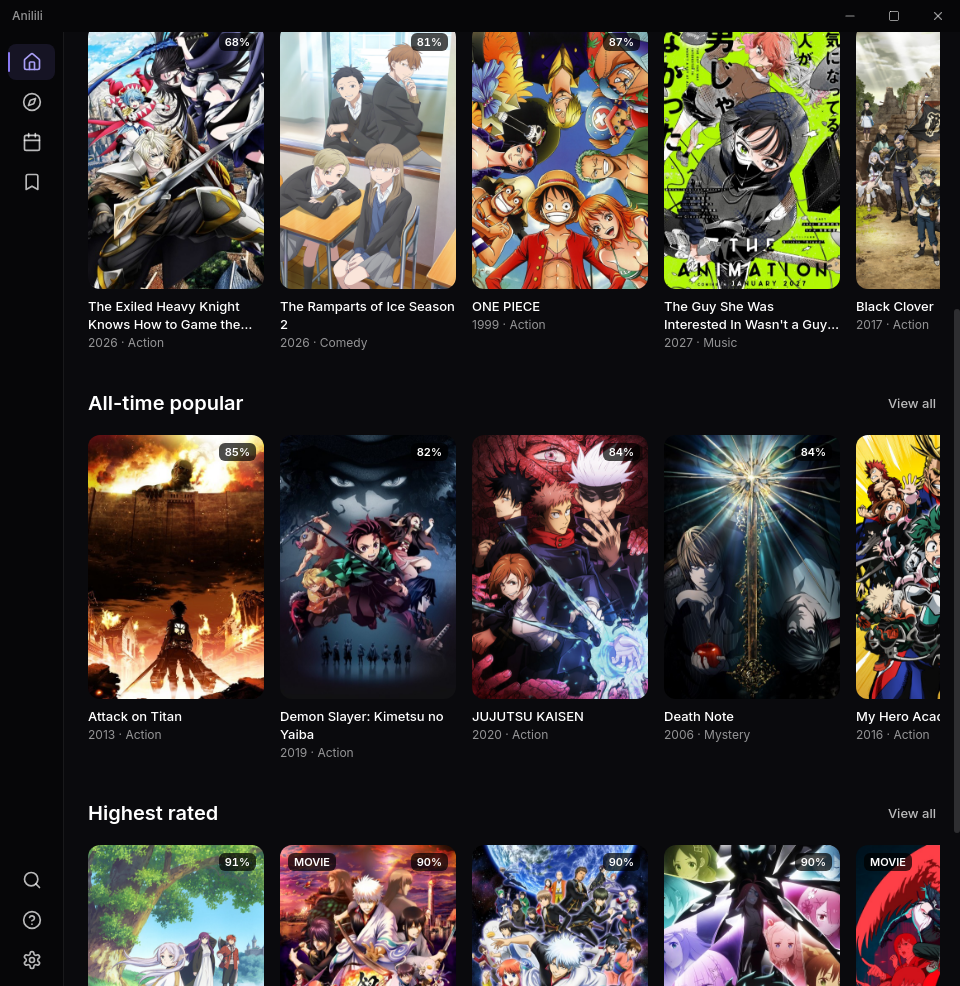
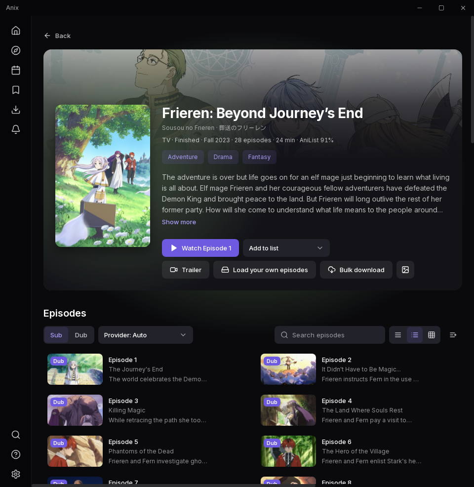
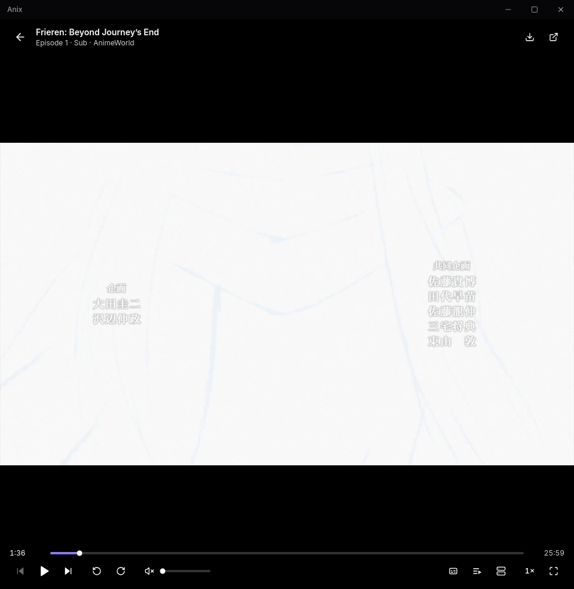
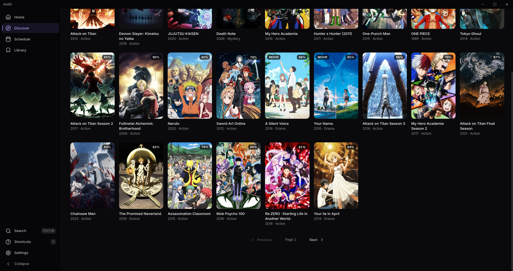
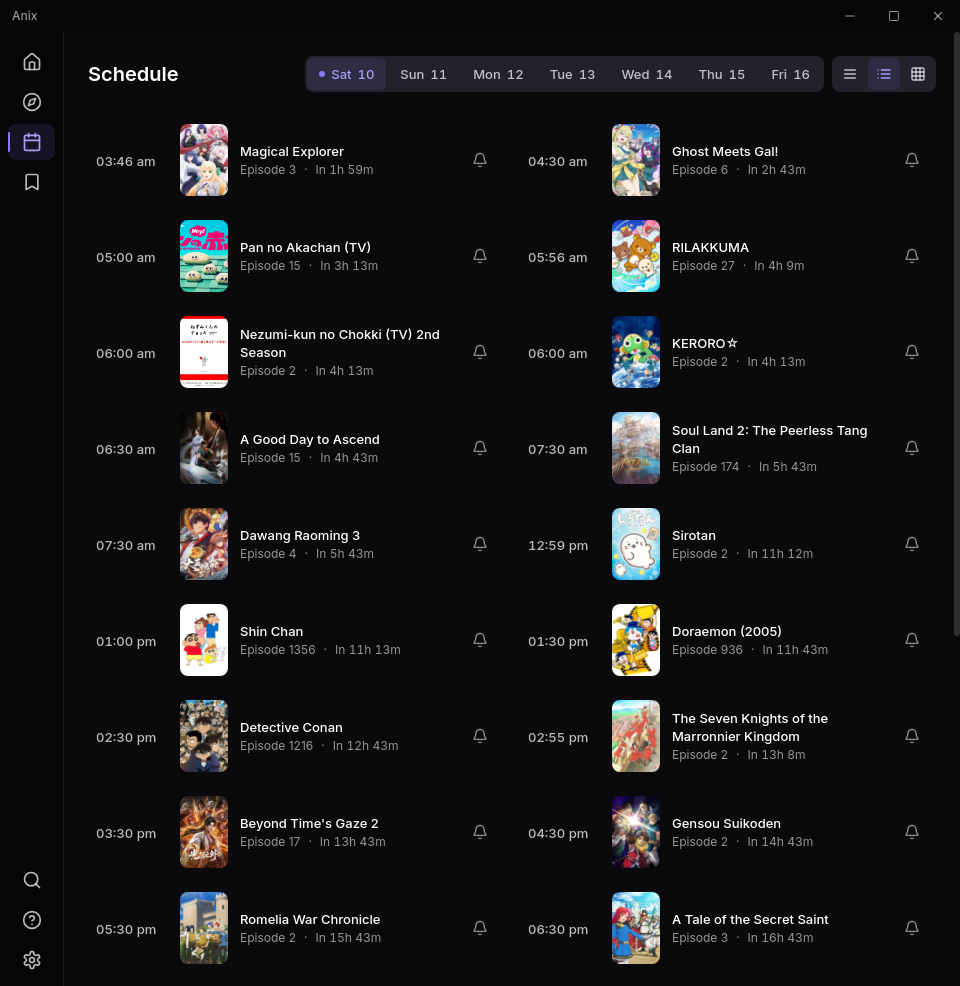
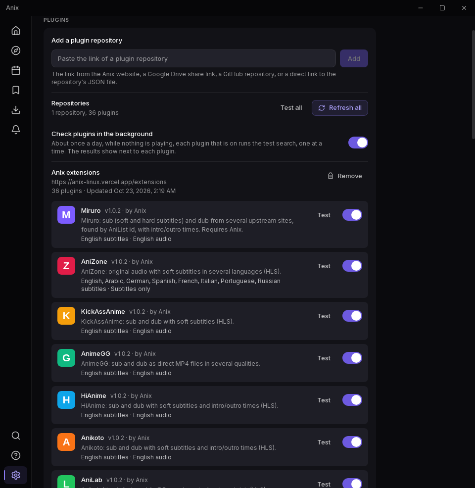

<div align="center">


# Anix

### An anime catalogue, tracker, and local library player for Linux

[-E95420?logo=linux&logoColor=white)](https://anix-linux.vercel.app)
[](CHANGELOG.md)
[](LICENSE)

<p align="center">
  <b>Anix</b> is a native Linux desktop application for cataloguing and tracking anime. Browse the AniList catalogue, keep your AniList, MyAnimeList, and Comick watchlists in sync, follow weekly airing schedules with desktop notifications, and organize and play your local anime media library using the built-in player or MPV / VLC. Zero telemetry.
</p>

**Website:** <https://anix-linux.vercel.app> • **Codeberg:** <https://codeberg.org/MaidLover69/Anix>

</div>

---

## Contents

- [Screenshots](#screenshots)
- [Features](#features)
- [Installation](#installation)
- [Extensions](#extensions)
- [Keyboard Shortcuts](#keyboard-shortcuts)
- [Built With](#built-with)
- [License](#license)

---

## Screenshots

| Home | Anime Page |
| :---: | :---: |
|  |  |
| **Player** | **Discover** |
|  |  |
| **Schedule** | **Library** |
|  |  |

---

## Features

### Catalogue & Discovery
- **AniList Catalogue**: Comprehensive home, discover, and search views with detailed metadata, episode lists, character information, and recommendations.
- **Theme Songs & Metadata**: Opening and ending theme listings and episode markers.
- **Quick Peek**: Instant hover previews for anime titles across catalogue grids.
- **Surprise Me**: One-click random title discovery.

### Tracker & Progress Sync
- **AniList, MyAnimeList & Comick**: Seamless tracker authentication. Finished episodes update your watch progress automatically, and watchlist status is synchronized bidirectionally.
- **Watch History & Resume**: Local per-episode watch history with timestamp resume and progress indicators.
- **Stats Dashboard**: Library view with detailed anime watching statistics.

### Local Media Library & Linking
- **Local Episode Linking**: "Load your own episodes" on any anime's page to link local media folders or video files directly to that title.
- **Smart Folder Scanner**: Automatically scans local media directories (e.g. `~/Videos/Anime`), recognizes release filenames, maps series titles and episode numbers, fetches AniList posters, and tracks progress.
- **Companion Subtitles**: Automatically detects and loads adjacent subtitle files for local episodes.
- **Playlists & Queues**: Create custom playlists, continuous playback, and export `.m3u` playlists for external players.

### Video Player & Audio Controls
- **Integrated Player**: Hardware-accelerated video playback with subtitle customisation (ASS, SRT, WebVTT font, size, styling, and timing delay).
- **Secondary Subtitles**: Display two subtitle tracks simultaneously (e.g. learning languages) with secondary subtitles positioned at the top of the screen.
- **Subtitle Drag & Drop**: Drop subtitle files directly onto the player window.
- **AniSkip**: Automatic or one-click skip for opening and ending sequences.
- **Dialogue Boost**: Intelligent audio speech enhancement for clearer dialogue.
- **External Player Support (mpv & VLC)**: 1-click external player launch with active subtitle passthrough and bidirectional progress synchronization for mpv.
- **Mini-Player**: Compact floating player mode for multitasking.

### Desktop Integration & System
- **MPRIS Media Controls**: Full desktop media keys and lockscreen playback control integration.
- **System Tray**: Optional background tray icon with airing notifications when the main window is closed.
- **Hardware Acceleration Check**: In-app diagnostic tool to verify system GPU video decoding.
- **Offline Mode**: Automatic local caching for home, searches, and anime details when internet or AniList is unreachable.
- **Airing Alerts**: Weekly broadcast schedule calendar with countdown timers and desktop notifications.

### Interface & Performance
- **Built for Linux**: Lightweight native desktop client powered by Tauri v2 and Rust. Low memory footprint and snappy performance.
- **Customizable Themes**: Dark, Light, Mocha, Hacker, Dracula, Tokyo Night, Manga, Comic, and pure OLED Black themes with system accent color matching and dynamic cover art ambient glow.
- **Keyboard-Driven**: Quick search with <kbd>Ctrl</kbd> + <kbd>K</kbd> and comprehensive in-player hotkeys.
- **Privacy First**: No analytics or telemetry.

---

## Extensions

Anix features a modular plugin architecture supporting JavaScript extensions for custom community providers and metadata resolvers.

- **Sandboxed Execution**: Extensions execute within an isolated QuickJS JavaScript engine without direct access to system files or OS processes.
- **Seanime Provider Compatibility**: Extensions follow the standard `onlinestream-provider` format.
- **Language Preferences**: Configurable priority for subtitle and audio dub languages (Settings › Sources).
- **Easy Management**: Add, enable, test, or configure provider links directly in **Settings → Plugins**.

---

## Installation

Packages for Linux are available from the project website: <https://anix-linux.vercel.app/download> and [Codeberg Releases](https://codeberg.org/MaidLover69/Anix/releases).

- **Direct AppImage Download:** [Anix_1.1.0_amd64.AppImage](https://drive.google.com/file/d/1c5IhzjZMVEbJJ6K3B1bZxlU4nWjh8ChI/view?usp=sharing)

### AppImage (Universal, any distribution)

```bash
chmod +x Anix_1.2.0_amd64.AppImage
./Anix_1.2.0_amd64.AppImage
```

*(Wayland note: On certain Wayland compositors, if an EGL display error occurs, launch with: `LD_PRELOAD=/usr/lib64/libwayland-client.so ./Anix_1.2.0_amd64.AppImage`)*

---

## Where Anix Stores Data

| Item | Location |
| :--- | :--- |
| Database, watch history, settings | `~/.local/share/anix/` |
| Configuration | `~/.config/anix/settings.json` |
| Image cache | `~/.cache/anix/` |

---

## Keyboard Shortcuts

During playback:

| Key | Action |
| :--- | :--- |
| <kbd>Space</kbd> / <kbd>K</kbd> | Play / Pause |
| <kbd>F</kbd> | Toggle fullscreen |
| <kbd>M</kbd> | Toggle mute |
| <kbd>→</kbd> / <kbd>←</kbd> | Seek 5 seconds (<kbd>Shift</kbd>: 30s) |
| <kbd>L</kbd> / <kbd>J</kbd> | Seek 10 seconds |
| <kbd>↑</kbd> / <kbd>↓</kbd> | Volume up / down (5%) |
| <kbd>Shift</kbd> + <kbd>N</kbd> / <kbd>P</kbd> | Next / Previous episode |
| <kbd>S</kbd> | Skip intro / outro |
| <kbd>Esc</kbd> | Exit fullscreen |

Anywhere in the app: <kbd>Ctrl</kbd> + <kbd>K</kbd> opens search, <kbd>?</kbd> shows keyboard shortcuts.

---

## Built With

- **Frontend**: React 18, TypeScript, Tailwind CSS, Vite, TanStack Query, Zustand, Lucide.
- **Backend**: Rust, Tauri v2, Tokio, WebKitGTK, QuickJS sandbox.

---

## License

Distributed under the **MIT License**. See [LICENSE](LICENSE) for details.
